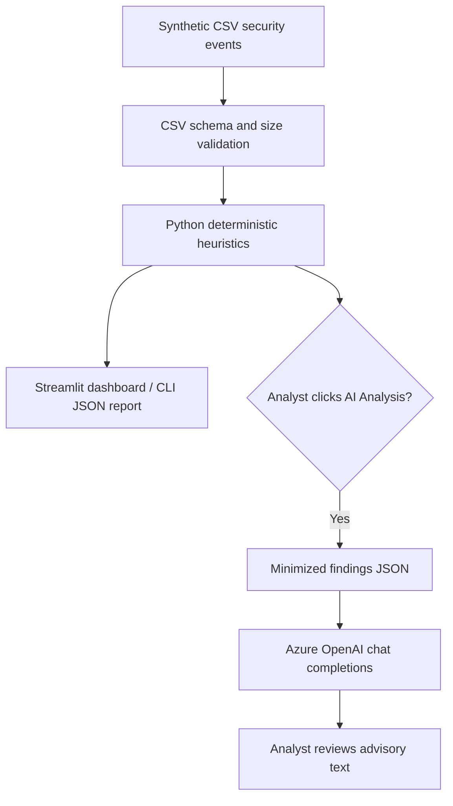

# Architecture and trust boundaries

**Trust boundary:** The CSV and any field values are untrusted. Heuristic findings are
not proof of compromise. The language model only provides advisory narrative; it
cannot execute remediation. The app does not connect to Sentinel or ingest live Azure logs.

**Production hardening ideas:** Microsoft Entra ID authentication, Azure Key Vault,
managed identity where supported, network restrictions, rate limits, PII redaction,
structured model-output validation, audit trails, observability, and approval workflows.
